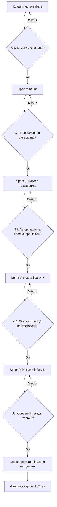

# Життєвий цикл проєкту UniTutor

**Проєкт:** UniTutor - платформа пошуку репетиторів серед студентів

---

## 5.1. Обрана модель життєвого циклу

**Модель:** Scrum  
**Тип:** адаптивна (Agile)

Scrum є доцільним вибором для UniTutor, оскільки це невеликий освітній вебзастосунок із середнім рівнем невизначеності вимог. Основні функції визначені заздалегідь, але деталі реалізації профілів, пошуку репетиторів, узгодження занять і відгуків можуть уточнюватися під час розробки. Поділ роботи на короткі спринти дає змогу поступово створювати функціонал, тестувати його та виправляти помилки. Такий підхід також допомагає контролювати виконання проєкту в умовах обмеженого часу та ресурсів.

---

## 5.2. Фази життєвого циклу

| № | Назва фази | Мета фази | Тривалість (тижнів) | Ключові роботи | Deliverables (проміжні результати) | Відповідальний |
|---|---|---|---:|---|---|---|
| 1 | **Концептуальна** | Визначити проблему, цілі, аудиторію та основні вимоги | 1 | Аналіз проблеми пошуку репетиторів; визначення цільової аудиторії; формування вимог; визначення основних функцій | Project Brief; перелік вимог; визначені цілі та межі проєкту | Team Lead |
| 2 | **Проєктування** | Спроєктувати структуру платформи та інтерфейс | 1 | Визначення архітектури; розробка макетів сторінок; проєктування структури бази даних; вибір технологій | Макети інтерфейсу; схема даних; структура системи | Developer |
| 3 | **Розробка - Sprint 1** | Створити базову версію платформи | 2 | Налаштування проєкту; створення основних сторінок; реалізація реєстрації та авторизації; створення профілів користувачів | Базовий прототип; авторизація; профілі студентів і репетиторів | Developer |
| 4 | **Розробка - Sprint 2** | Реалізувати пошук репетиторів і запити на заняття | 2 | Реалізація пошуку за дисциплінами; перегляд профілів; надсилання запитів; збереження статусів запитів; тестування | Робочий пошук; сторінки профілів; система запитів на заняття | Developer / Tester |
| 5 | **Розробка - Sprint 3** | Реалізувати додаткові функції та вдосконалити платформу | 2 | Узгодження розкладу; реалізація відгуків та оцінювання; перевірка зручності інтерфейсу; виправлення помилок | Додаткові модулі; система відгуків; результати тестування | Developer / Tester |
| 6 | **Завершення** | Перевірити готовність продукту та підготувати фінальну версію | 1 | Фінальне тестування; перевірка відповідності вимогам; виправлення критичних помилок; оновлення документації; підготовка демонстрації | Фінальна версія UniTutor; результати тестування; документація; демонстраційна версія | Team Lead / Tester |

**Примітка:** загальна запланована тривалість становить 9 тижнів. Тривалість є орієнтовною та може коригуватися залежно від навчального навантаження й складності реалізації. Додаткові функції можуть бути перенесені, якщо основний функціонал потребуватиме більше часу.

---

## 5.3. Ворота між фазами

| Ворота | Між фазами | Критерії переходу | Можливі рішення |
|---|---|---|---|
| **G1** | Концептуальна → Проєктування | Визначено проблему, цілі, цільову аудиторію, основні вимоги та межі проєкту | Go / Rework / Kill |
| **G2** | Проєктування → Sprint 1 | Підготовлено макети інтерфейсу, визначено структуру системи, основні сутності даних і технології | Go / Rework / Kill |
| **G3** | Sprint 1 → Sprint 2 | Реалізовано базову структуру платформи, реєстрацію, авторизацію та профілі; критичні помилки відсутні | Go / Rework / Kill |
| **G4** | Sprint 2 → Sprint 3 | Працюють пошук репетиторів, перегляд профілів і надсилання запитів на заняття; основні сценарії протестовано | Go / Rework / Kill |
| **G5** | Sprint 3 → Завершення | Реалізовано заплановані додаткові функції або визначено їх перенесення; основний функціонал протестовано | Go / Rework / Kill |

Рішення **Go** означає перехід до наступної фази, **Rework** — необхідність доопрацювання поточного етапу, а **Kill** — припинення проєкту в разі неможливості або недоцільності його продовження.

---

## 5.4. Візуалізація життєвого циклу

Діаграма показує послідовність основних фаз і контрольні точки між ними. Якщо критерії переходу не виконані, передбачено повернення до поточного етапу для доопрацювання. Додаткові можливості можуть бути перенесені за межі початкової версії, якщо це необхідно для дотримання строків.

---

## 5.5. Обґрунтування вибору моделі

UniTutor є невеликим освітнім вебзастосунком, який розробляється в межах навчального курсу з обмеженим часовим бюджетом. Основні вимоги вже визначені, проте окремі деталі пошуку репетиторів, організації занять і системи відгуків можуть змінюватися під час реалізації. Тому адаптивна модель Scrum дає змогу уточнювати пріоритети та поступово вдосконалювати продукт.

Як альтернативу можна було обрати каскадну модель Waterfall. Проте вона передбачає послідовне проходження фаз і менш зручна, коли вимоги уточнюються в процесі роботи. Інкрементна модель також підходить для UniTutor, оскільки дозволяє додавати функціональність частинами, але Scrum додатково передбачає регулярне планування, перевірку результатів і коригування наступних завдань.

Основною перевагою Scrum для цього проєкту є можливість розділити розробку на короткі спринти. Спочатку створюється базова платформа з авторизацією та профілями, потім додаються пошук і запити на заняття, а після цього — додаткові можливості. Така послідовність дозволяє раніше отримати працездатний продукт і перевірити найважливіші сценарії використання.

Основними ризиками є нестача часу, помилки під час розробки, недостатня кількість тестових користувачів і можливі труднощі з реалізацією всіх запланованих функцій. Для зменшення цих ризиків необхідно визначати пріоритетність завдань, тестувати функціонал після кожного спринту та спочатку зосередитися на обов'язкових можливостях платформи.

Отже, Scrum є доцільною моделлю життєвого циклу UniTutor, оскільки поєднує поступову розробку, регулярне тестування та можливість коригування планів. Це допоможе створити працездатну платформу в межах доступних ресурсів і підготувати її до демонстрації наприкінці навчального курсу.
